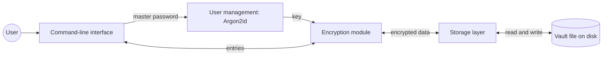

# Secure Password Manager (Provisional)

Secure Password Manager (SPM) is a CLI password manager written in C for the ICS0022. It will let a user store, view, and delete passwords in one encrypted vault file.

## Scope and planned commands

- `./spm init` — create a vault and set a master password.
- `./spm add <service>` — add a username and password.
- `./spm get <service>` — show a saved username and password.
- `./spm del <service>` — delete an entry.

## Design choices

SPM will use `libsodium` for encryption and key derivation. It provides tested cryptographic functions, so the project does not need to implement encryption itself.

Argon2id will turn the master password into an encryption key. XChaCha20-Poly1305 will encrypt the whole vault and detect changes to its contents.

The vault file will contain a version number, a random salt, the Argon2id settings, a random nonce, and encrypted data. It will not contain the master password or encryption key.

Before encryption, entries will use this text format:

```text
base64(service):base64(username):base64(password)
```

Each entry will be on its own line. Base64 keeps `:` and newlines inside a field from breaking the format. The program will check field lengths and reject invalid data.

## Architecture



The command-line interface takes commands and asks for the master password. User management derives a key from that password. The encryption module uses the key to decrypt or encrypt vault entries. The storage layer reads and writes the vault file.

The master password, key, and decrypted entries exist in the running program's memory. The vault file on disk holds encrypted entries.

## Threat model

| Area | Threat | Planned mitigation |
|---|---|---|
| Master password | Someone copies the vault file and tries to guess the master password. | Use Argon2id with a random salt so each guess takes time and memory. |
| Vault on disk | Someone reads the vault file. | Encrypt the whole vault with XChaCha20-Poly1305. |
| Vault on disk | Someone changes the vault file. | Check the authentication tag during decryption and reject changed data. |
| Vault in memory | Passwords or keys remain in memory after use. | Clear the master password, key, and decrypted vault data with `sodium_memzero()` when they are no longer needed. Use `sodium_mlock()` where possible to reduce swapping. |
| Interface | Long or invalid input causes a crash or buffer overflow. | Set size limits, check input lengths and return values, and reject invalid input. |
| Interface | A password shown by `get` remains visible in the terminal. | Show it only when requested. Users should run SPM in a trusted terminal and be aware of terminal scrollback. |

## Planned build and run

SPM is intended to run on Ubuntu or WSL. The planned dependencies are a C compiler and `libsodium-dev`:

```bash
sudo apt-get update
sudo apt-get install build-essential libsodium-dev
gcc -Wall -Wextra -Werror -o spm *.c -lsodium
```

Once the C source files are added, the program will be compiled with `gcc`, using `-Wall -Wextra -Werror` and linking against `libsodium`. The exact build command will be added when the source file names are known.

The planned way to run it is:

```bash
./spm init
./spm add github
./spm get github
./spm del github
```