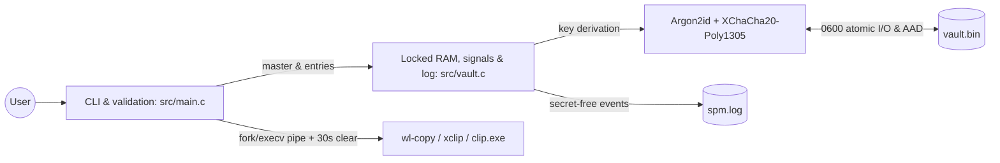

# Secure Password Manager

Secure Password Manager (`spm`) is a single-user CLI and interactive password manager in C for ICS0022 Secure Programming.
It keeps encrypted credentials in `vault.bin` and writes event records (with no secrets) to `spm.log`.

## Commands

Run `./spm` with no arguments to open the interactive `spm> ` prompt, or pass one command directly on the command line:

- `./spm`: Start an interactive `spm> ` session (`exit`, `quit`, or `Ctrl+D` exits cleanly).
- `./spm init`: Create `vault.bin` and set a master password (`8` to `126` characters, confirmed twice).
- `./spm add <service>`: Add or update a username and password.
- `./spm list`: List saved services and usernames (passwords are never printed).
- `./spm get <service>`: Copy the password to the clipboard and print `<service> (user: ...)` and `<service> (pass: in clipboard)`.
- `./spm del <service>`: Delete one entry from the vault.
- `./spm del-vault`: Unlock, confirm by typing `YES`, overwrite, and delete `vault.bin`.
- `./spm help` (or `--help`): Show command usage.

## Security and design

### Cryptography and vault format
- **Key derivation:** `Argon2id` (`crypto_pwhash`, interactive limits) turns the master password and a fresh 16-byte random salt into a 32-byte key on every save. The master password is never stored on disk.
- **Authenticated encryption:** `XChaCha20-Poly1305` (`crypto_aead_xchacha20poly1305_ietf`) encrypts up to `50` fixed-size `Credential` records (`MAX_ENTRIES = 50`).
- **Header and AAD:** `vault.bin` starts with a `48`-byte `"SPM1"` header (`magic`, `version`, `fail_count`, `reserved[2]`, `salt`, `nonce`). All immutable header fields are verified via `AAD` (with `fail_count` at byte offset `5` masked to `0`). Changing any protected byte fails decryption.

### Authentication and brute-force protection
- **Interactive unlock retry:** Wrong passwords stay inside the `Master password:` prompt until you enter the right password, press `Ctrl+D` to cancel, or reach the failure limit.
- **10-attempt wipe:** Byte `5` (`fail_count`) tracks consecutive failed unlocks using `pwrite()` + `fsync()`. A valid unlock resets it to `0`; `10` consecutive failures overwrite `vault.bin` with random bytes and delete it.

### File and access control
- **Safe vault creation:** `vault_create()` uses `O_CREAT`, `O_EXCL`, `O_NOFOLLOW`, and `O_NONBLOCK` (`0600`) so `init` cannot overwrite an existing file or symlink in a race.
- **Atomic updates:** `vault_save()` writes a temporary file (`0600`), flushes it with `fsync()`, swaps it in with `rename()`, and syncs the parent directory while blocking `SIGINT` and `SIGTERM`.
- **Owner-only checks:** `vault.bin` must be a regular file (`S_ISREG`) owned by your `UID` and `GID` with `0600` permissions. Symlinks and named pipes (`FIFO`) are rejected.

### Memory and process safety
- **Swap locking:** Secret buffers (`master`, `entries`, encryption keys, password inputs, and edit/delete backups) are allocated with `sodium_malloc()` guard pages, locked into physical RAM with verified `sodium_mlock()`, and wiped/unlocked with `sodium_free()` (`sodium_memzero()`).
- **No core dumps:** Startup disables crash dumps and non-root `/proc/<pid>/mem` reads using `setrlimit(RLIMIT_CORE, 0)` and Linux `prctl(PR_SET_DUMPABLE, 0)`.

### Input, signals, clipboard, and logging
- **Input rules:** Services and usernames allow only `[A-Za-z0-9._-@+]` (no `.` or `..`). Passwords reject ASCII control bytes (`< 0x20` and `0x7F`).
- **Timed clipboard:** `get` runs `wl-copy`, `xclip`, or `clip.exe` directly via `pipe()`, `fork()`, and `execv()` from absolute `PATH` folders only (no `/bin/sh`), and spawns a detached secret-free timer child that clears the clipboard after `30` seconds (`CLIPBOARD_TTL_SEC`, configurable downward via `SPM_CLIP_TIMEOUT`).
- **Signals and echo:** Terminal `ECHO` is turned off before printing password prompts and restored before `Ctrl+C` (`Exit cleanly? [y/N]:`), `SIGTERM`, and `SIGHUP` exits. `Ctrl+Z` (`SIGTSTP`) is ignored so an unlocked vault cannot be paused in background RAM.
- **Audit log (`spm.log`):** Writes allowlisted `[A-Za-z0-9_-]` UTC event records (`ts=... uid=... pid=... event=... outcome=... detail=...`) using `O_NOFOLLOW`, `O_NONBLOCK`, `S_ISREG`, UID checks, and `0600` mode. No passwords, usernames, service names, or raw `errno` text are logged.

## Architecture



- **`src/main.c`:** Command parsing, input allowlists, unlock retries, `del-vault`, and timed shell-free clipboard piping.
- **`src/vault.c` & `src/vault.h`:** Signal handling, hidden input, RAM locking, core-dump blocking, Argon2id/AEAD crypto, vault storage, 10-attempt wipe, and `spm.log`.

## Threat model

| Area | Threat | Mitigation |
|---|---|---|
| Master password | Brute-forcing a copied `vault.bin` offline | `Argon2id` with a fresh 16-byte random salt slows down each guess. |
| Interactive guessing | Guessing the password repeatedly on the machine | `10` consecutive failed unlocks overwrite and delete `vault.bin`. |
| Files on disk | Other users, symlinks, FIFOs, or `init` file-swap races | `0600` mode, `UID`/`GID` checks, `O_NOFOLLOW`, `O_NONBLOCK`, and `O_EXCL`. |
| File tampering | Modifying vault header, ciphertext, or tag | `XChaCha20-Poly1305` verifies both records and immutable `48`-byte header bytes (`AAD`). |
| Secrets in RAM | Passwords leaking to swap, core dumps, or `/proc/pid/mem` | `sodium_malloc()` + `sodium_mlock()`, `RLIMIT_CORE = 0`, `PR_SET_DUMPABLE = 0`, and `sodium_memzero()`. |
| Interface & clipboard | Shell/log injection, scrollback leaks, stuck clipboard, or stuck echo | Allowlists, `fork()`/`execv()` without `/bin/sh`, 30s clipboard auto-clear, `SIGTSTP` ignored, and `ECHO` restored on signals. |
| Audit log | Log tampering by other users or log injection | `spm.log` (`0600`, `UID` check, `O_NOFOLLOW`, `O_NONBLOCK`) accepts only safe tokens and logs zero secrets. |

## Build, test, and run

### Prerequisites (Ubuntu or WSL)

```bash
sudo apt update
sudo apt install -y build-essential libsodium-dev python3 wl-clipboard xclip
```

### Build and test

Compile with strict warning and hardening flags (`-O2 -Wall -Wextra -Werror -pedantic -fanalyzer -D_FORTIFY_SOURCE=2 -fstack-protector-strong -fPIE` with `-pie` when linking):

```bash
make
```

Run the automated test suite (`7` test groups) and the sanitizer build (`ASan` + `UBSan`):

```bash
make test
make asan
```

Remove build files (`obj/`, `spm`, `spm_asan`) while keeping `vault.bin` and `spm.log`:

```bash
make clean
```

### Usage examples

```bash
# Interactive mode
./spm

# One-shot CLI mode
./spm init
./spm add github.com
./spm list
./spm get github.com
./spm del github.com
./spm del-vault
```
