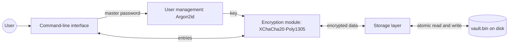

# Secure Password Manager

Secure Password Manager (SPM) is a single-user CLI password manager written in C for the ICS0022 Secure Programming course. It lets a user store, view, and delete credentials inside one encrypted vault file (`vault.bin`).

## Scope and commands

- `./spm init`: Create a new vault and set a master password.
- `./spm add <service>`: Add or update a username and password for a service.
- `./spm list`: Show saved services and usernames (passwords are never shown).
- `./spm get <service>`: Copy a password directly to the system clipboard without printing it.
- `./spm del <service>`: Delete an entry from the vault.
- `./spm help`: Show command usage.

## Design choices

SPM uses `libsodium` for cryptographic operations and key derivation:

- **Key derivation:** `Argon2id` (`crypto_pwhash`) turns the master password into an encryption key using a fresh 16-byte random salt. The master password itself is never written to disk.
- **Authenticated encryption:** `XChaCha20-Poly1305` (`crypto_aead_xchacha20poly1305_ietf`) encrypts all vault entries. If the password is wrong or the file was changed, decryption fails immediately.
- **Binary records format:** Entries use fixed-size binary records (`Credential` struct) instead of text files. This avoids delimiter bugs and string injection problems.
- **Atomic file writes:** Changes are written to a temporary file first. The file is synced to disk with `fsync()` and moved into place with `rename()`. Permissions are restricted to owner-only (`0600`). This protects against file corruption if interrupted.
- **Memory safety:** Passwords, keys, and decrypted records are wiped from memory using `sodium_memzero()` before the program exits.
- **Hidden input and clipboard output:** Typing is hidden with `<termios.h>` when entering passwords. The `get` command copies passwords directly to clipboard tools (`wl-copy`, `xclip`, `clip.exe`). Passwords never appear on screen or in shell history.

## Architecture



- **Command-line interface (`src/main.c`):** Parses arguments, validates inputs, and coordinates commands.
- **User management & crypto (`src/vault.c`):** Uses `Argon2id` to derive the vault key, and `XChaCha20-Poly1305` to encrypt and decrypt records.
- **Storage layer (`src/vault.c`):** Manages file I/O, atomic temporary file replacement, file permissions, and data integrity.
- **Vault file (`vault.bin`):** Holds a 16-byte random salt, a 24-byte random nonce, and the encrypted records with a 16-byte Poly1305 authentication tag.

## Threat model

| Area | Threat | Implemented mitigation |
|---|---|---|
| Master password | Someone copies the vault file and tries to guess the master password. | `Argon2id` with a 16-byte random salt makes guessing the password very slow and memory-heavy. |
| Vault on disk | Someone reads the vault file directly. | All entries are encrypted at rest with `XChaCha20-Poly1305`. File permissions are set to owner-only (`0600`). |
| Vault on disk | Someone alters or corrupts bytes in the vault file. | Poly1305 checks the data during decryption. Any altered byte causes immediate rejection with a generic error. |
| Vault in memory | Passwords or keys remain in RAM after the program finishes. | Master passwords, keys, and decrypted records are wiped with `sodium_memzero()` before exit. |
| Interface | Oversized input or invalid characters cause memory corruption. | Input lengths are limited with `fgets()`. Extra characters in stdin are cleared, and service names only allow printable characters. |
| Interface | A retrieved password remains visible in terminal scrollback. | Passwords are never printed on screen. The `get` command sends the secret straight to system clipboard helpers (`wl-copy`, `xclip`, `clip.exe`). |

## Build and run

### Prerequisites (Ubuntu or WSL)

```bash
sudo apt update
sudo apt install -y build-essential libsodium-dev wl-clipboard xclip
```

### Build

Compile the program with security flags (`-Wall -Wextra -Werror -pedantic -fanalyzer -D_FORTIFY_SOURCE=2 -fstack-protector-strong`):

```bash
make
```

To clean build artifacts:

```bash
make clean
```

### Usage example

```bash
# 1. Initialize a new vault
./spm init

# 2. Add an entry
./spm add github

# 3. List entries (shows services and usernames, never passwords)
./spm list

# 4. Copy password to clipboard
./spm get github

# 5. Delete an entry
./spm del github
```
